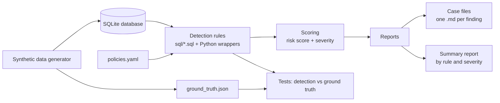

# Access Log Auditor

A Python tool that audits synthetic data-access logs against a written access policy and produces investigation reports. It simulates how a security compliance team reviews who queried sensitive data and whether that access was allowed.

> **All data in this project is synthetic.** Every user, dataset, query, and IP address is generated with Faker. No real data or credentials are used, and none should ever be committed.

## The problem it solves

Organizations hold sensitive data (salaries, customer records, financials) and grant access by role and by approval. Over time, grants expire, people change roles, and some queries go beyond what was approved. Nobody can read 20,000 log lines by hand.

This tool reads a query log, checks every entry against a policy file, scores what it flags, and writes a case file for each finding. A reviewer can then decide what to do: revoke access, ask the manager, or escalate.

## Architecture



## Features

- Synthetic generator: about 50 users, 12 datasets, and 20,000 log entries with realistic daily patterns
- 6 to 8 planted violations saved to a ground-truth file, so detection can be measured
- Six detection rules, each a `.sql` file with a Python wrapper
- Policy-driven: thresholds, roles, business hours, and sensitive columns live in `policies.yaml`
- Risk score and severity (LOW, MEDIUM, HIGH) per finding
- One markdown case file per finding, plus a summary report
- Unit tests per rule and a test that compares detection against the planted ground truth

## Data model

| Table | Columns |
|---|---|
| `users` | user_id, name, team, role, manager |
| `datasets` | dataset_id, name, sensitivity (PUBLIC, INTERNAL, CONFIDENTIAL, RESTRICTED), owner_team |
| `access_grants` | user_id, dataset_id, granted_on, expires_on, justification |
| `query_log` | query_id, user_id, timestamp, dataset_id, sql_text, columns_accessed, rows_returned, source_ip, success |

## Detection rules

| # | Rule | Flags | Source |
|---|---|---|---|
| 1 | No valid grant | Access with no grant, or a grant that had expired on the query date | `sql/01_no_valid_grant.sql` |
| 2 | Sensitive columns | A sensitive column accessed without an explicit grant for it | `sql/02_sensitive_columns.sql` |
| 3 | Bulk export | Rows returned far above the user's own 30-day baseline | `sql/03_bulk_export.sql` |
| 4 | Off-hours RESTRICTED | RESTRICTED data accessed outside business hours | `sql/04_off_hours.sql` |
| 5 | Role mismatch | Role not permitted for the dataset's sensitivity level | `sql/05_role_mismatch.sql` |
| 6 | Volume spike | Daily query count with a z-score above 3 for that user | `sql/06_volume_spike.sql` |

## Scoring

Each finding earns points by rule. A finding's points are added up per user and query, then mapped to a severity.

| Rule | Points |
|---|---|
| 1 No valid grant | 40 |
| 5 Role mismatch | 35 |
| 2 Sensitive columns | 30 |
| 3 Bulk export | 25 |
| 4 Off-hours RESTRICTED | 20 |
| 6 Volume spike | 15 |

Add 10 points if the dataset is RESTRICTED, and cap the total at 100.

| Score | Severity | Typical action |
|---|---|---|
| 0 to 29 | LOW | Log and monitor |
| 30 to 59 | MEDIUM | Ask the user's manager |
| 60 to 100 | HIGH | Revoke access and escalate |

## How to run

Requires Python 3.11+.

```bash
git clone <your-repo-url>
cd access-log-auditor
python -m venv .venv
source .venv/bin/activate        # Windows: .venv\Scripts\Activate.ps1
pip install -r requirements.txt

# 1. Create the synthetic database and the ground-truth file
python -m auditor.cli generate-data

# 2. Run all six detection rules and score the findings
python -m auditor.cli audit

# 3. Write one case file per finding plus the summary report
python -m auditor.cli report

# Run the tests
pytest
```

Generated databases and reports are git-ignored.

## Worked example

**Case: access to RESTRICTED data with no grant**

| | |
|---|---|
| **Who** | Maria Lopez, Marketing analyst (manager: Chen Wei) |
| **What** | Queried `salaries` (RESTRICTED, owned by HR) and received 40 rows |
| **When** | Tuesday, 10:15 |
| **Policy violated** | Access requires a valid, unexpired grant. Marketing analysts may not access RESTRICTED data. |
| **Rules triggered** | 1 (no valid grant) and 5 (role mismatch) |
| **Score** | 40 + 35 + 10 (RESTRICTED) = 85, **HIGH** |
| **Recommended action** | Revoke access, notify her manager, and ask for the business reason |

Evidence:

```sql
SELECT employee_id, salary FROM salaries WHERE department = 'Engineering';
```

The finding fires two rules at once, and that combination is why the score is HIGH. Either rule alone would have scored MEDIUM.

## Design decisions

- **Bulk export: 5x the user's own 30-day median, with at least 14 days of history.** A global row limit would flag analysts who always run large queries and miss someone who suddenly jumps from 200 rows to 2,000. A per-user baseline measures change. The median resists a user's own one-off large queries. Users with fewer than 14 days of history are skipped by this rule and noted in the report as "insufficient baseline".
- **Z-score above 3 for volume spikes.** For roughly normal data, only about 0.1% of days exceed 3, so the rule stays quiet on ordinary busy days. Users with fewer than 30 days of history are skipped, because a standard deviation from a few days is unreliable.
- **RESTRICTED rows-per-query limit: 1,000.** Set in `policies.yaml`. A hard cap suits RESTRICTED data, where nobody has a legitimate reason to pull large volumes in one query.
- **Business hours: Monday to Friday, 08:00 to 18:00.** Only RESTRICTED datasets are checked for off-hours access. Applying it everywhere would flag nearly every on-call engineer.
- **The false-positive tradeoff.** A looser threshold catches more real violations but buries reviewers in noise, and real reviewers start ignoring noisy alerts. This tool leans toward fewer, higher-confidence findings. Severity scoring keeps weaker signals visible without making them urgent, and the report lists the false positives found so the trade-off is measurable.
- **Rules in SQL, policy in YAML.** Each rule can be read, tested, and run by hand in a database browser. The policy can change without touching code.
- **Ground truth defined before the detectors.** The planted violations were designed independently of the detection logic, so the recall numbers are not tuned to fit the generator.

## Results

Detection against the planted ground truth (seed `[SEED]`, 20,000 log entries):

| Planted violations | Caught | Missed | False positives |
|---|---|---|---|
| [N] | [N] | [N] | [N] |

False positives are mostly [describe the pattern you actually saw, for example legitimate quarterly exports that triggered the bulk-export rule]. The ground-truth test is in `tests/test_ground_truth.py`.

## Casebook

`casebook/` holds written-up example cases, one per file, each with who, what, when, the SQL evidence, the policy violated, severity, and the recommended action:

- [list your 5 to 8 case filenames here]

## Testing

```bash
pytest -v
```

- One test file per rule, using small hand-made fixtures: one clear violation, one clean row, and one near-miss
- A ground-truth test that runs the full audit on the generated data and compares findings to `ground_truth.json`

## Limitations

- The data is synthetic, so real logs will be messier (missing fields, shared accounts, odd formats).
- The rules are fixed thresholds, not learned models, so someone who knows them can stay just under them.
- It reads the log after the fact. It cannot block access in real time.
- The z-score assumes roughly normal daily volumes, which is not true for every user.
- SQLite is fine for 20,000 rows but is not built for very large logs.
- It cannot judge intent. A finding is a lead for a human reviewer, not a verdict.

## Repo structure

```
auditor/       db, generator, rules, scoring, report, cli
sql/           one .sql file per detection rule
tests/         unit tests per rule + ground-truth detection test
casebook/      written-up example cases
policies.yaml  roles, sensitivity levels, business hours, row limits, sensitive columns
```

## License

[Choose one, for example MIT.]
